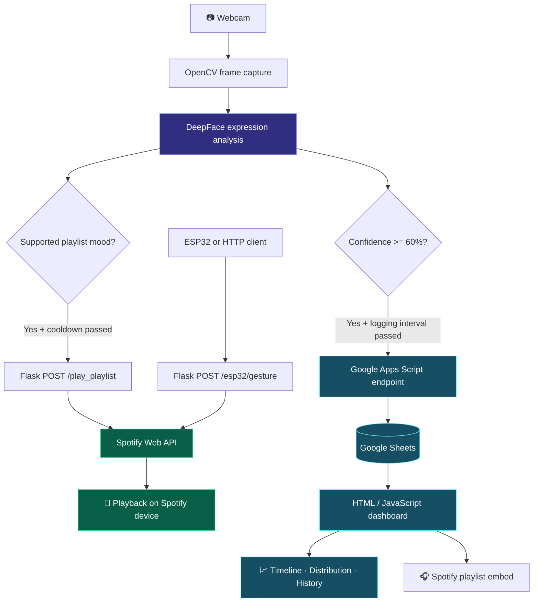

<div align="center">


### 🎧 Your face sets the vibe. Your music follows.

**An AI-powered, IoT-inspired music experience that reads facial expressions, chooses Spotify playlists, and turns emotion data into an interactive dashboard.**

<br />

[](https://www.python.org/)
[](https://opencv.org/)
[](https://developer.spotify.com/)
[](https://flask.palletsprojects.com/)
[](https://www.espressif.com/)

[](https://github.com/MrZayidKhan/EmotiTune/stargazers)
[](https://github.com/MrZayidKhan/EmotiTune/commits/main/)


<br />

[**✨ Explore Features**](#-the-experience) · [**🧠 How It Works**](#-behind-the-beats) · [**🚀 Get Started**](#-quick-start) · [**🔌 API**](#-api-reference) · [**🛣️ Roadmap**](#-whats-next)

</div>

---

## 💿 Not just a playlist. A playlist that reacts to you.

Ever spent more time searching for the *right* song than actually listening to music?

**EmotiTune** explores a different interaction: your webcam captures a frame, **DeepFace** estimates the expression on your face, and **Spotify** receives a playlist selected for that expression. Meanwhile, a lightweight dashboard shows your logged expression history, trends, and playlist recommendation.

No dropdown full of moods. No endless scrolling. Just **camera → AI → music**.

> [!NOTE]
> EmotiTune analyzes **facial expressions**, not private thoughts or a clinically verified emotional state. Its results are estimates, and the current repository is a **prototype**, not a production-ready wellness tool.

## ✨ The Experience

<table>
<tr>
<td width="50%" valign="top">

### 🧠 AI expression recognition

Uses **DeepFace + OpenCV** to analyze webcam frames and estimate the dominant facial expression and confidence score.

</td>
<td width="50%" valign="top">

### 🎶 Mood-matched Spotify

Maps four expressions to curated Spotify playlists and attempts to change playback when the detected expression changes.

</td>
</tr>
<tr>
<td width="50%" valign="top">

### 📊 Your emotional soundtrack, visualized

An animated dashboard offers a current-expression card, **timeline**, **distribution chart**, and **recent logs**.

</td>
<td width="50%" valign="top">

### ☁️ Google Sheets logging

Sends expression records to a configurable **Google Apps Script** endpoint and reads saved history back into the dashboard.

</td>
</tr>
<tr>
<td width="50%" valign="top">

### 🤖 ESP32 gesture-control endpoint

A Flask route accepts `play`, `pause`, `next`, and `previous` gesture commands from an external controller.

</td>
<td width="50%" valign="top">

### ⚡ Thoughtful processing

Background analysis runs on an approximately **3-second** interval, with frame-difference skipping and a **20-second** playlist-switch cooldown.

</td>
</tr>
</table>

## 🎭 Pick a face. Catch a vibe.

<div align="center">

| Expression | Vibe | Spotify mapping |
|:---:|:---|:---|
| 😊 **Happy** | Turn it up — good energy only | **Happy Hits** |
| 😢 **Sad** | Sometimes you need to feel the lyrics | **Sad Songs** |
| 😠 **Angry** | Reset the mood, cool the noise | **Calming vibes** |
| 😐 **Neutral** | A little soundtrack boost | **Mood Booster** |

</div>

**Also recognized by the dashboard:** 😱 Fear and 😲 Surprise. These currently have **no assigned Spotify playlist**. DeepFace can return other expression labels; not all of them are mapped in the dashboard or playback logic.

## 🧠 Behind the Beats



<details>
<summary><b>🔍 Nerd mode: current update intervals</b></summary>

<br />

| Operation | Behavior in the current code |
|---|---|
| Expression inference | At most once every **3 seconds**, with an unchanged-frame skip |
| Emotion logging | After **≥ 60%** confidence, subject to a **10-second** interval |
| Spotify playlist changes | On a mapped expression change, with a **20-second** cooldown |
| Dashboard data refresh | Polls Google Apps Script every **8 seconds** |
| Dashboard timeline | Displays the **20 most recent** valid entries |
| Recent emotion table | Displays the **10 most recent** valid entries |

These are code-level intervals, not guaranteed real-time performance. Device speed, network conditions, and external APIs can affect the experience.

</details>

## 🛠️ Built With

| Layer | Technology | Why it's here |
|---|---|---|
| **Vision** | OpenCV | Webcam capture, frame processing, overlay |
| **Expression AI** | DeepFace | Facial-expression classification |
| **Backend** | Python · Flask · Flask-CORS | Local endpoints for playback and gesture commands |
| **Music** | Spotipy · Spotify Web API | Authenticated Spotify playback control |
| **Data logging** | Google Apps Script · Google Sheets | Store and retrieve expression records |
| **Dashboard** | HTML · CSS · JavaScript | Responsive, animated experience |
| **Visualizations** | Chart.js | Expression timeline and distribution |
| **Motion** | Anime.js | Dashboard refresh interaction |
| **IoT interface** | ESP32-compatible HTTP endpoint | Receive gesture events from external hardware |

## 📁 Repository Layout

```text
EmotiTune/
├── Emotion_script.py     # Webcam AI + Flask API + Spotify + logging
├── index.html            # Dashboard + playlist embed + charts
└── README.md             # You are here ✨ (add this file)
```

**Why only two application files?** This is a compact proof of concept: one Python process powers computer vision and local HTTP endpoints, while one standalone HTML page handles the dashboard.

## 🚀 Quick Start

> [!IMPORTANT]
> **Some setup is required before the project will run end to end.** The repository contains placeholders for Spotify and Google Apps Script credentials/URLs; it does **not** include a Google Apps Script implementation or ESP32 firmware.

### 01 · Clone the project

```bash
git clone https://github.com/MrZayidKhan/EmotiTune.git
cd EmotiTune
```

### 02 · Create an environment & install dependencies

Use a Python version supported by your local DeepFace/TensorFlow installation (Python **3.10 or 3.11** is a reasonable starting point).

**Windows (PowerShell)**

```powershell
py -m venv .venv
.\.venv\Scripts\python.exe -m pip install --upgrade pip
.\.venv\Scripts\python.exe -m pip install opencv-python deepface requests flask flask-cors spotipy
```

**macOS / Linux**

```bash
python3 -m venv .venv
source .venv/bin/activate
python -m pip install --upgrade pip
python -m pip install opencv-python deepface requests flask flask-cors spotipy
```

Depending on your platform, DeepFace/TensorFlow may need additional compatible dependencies.

### 03 · Connect Spotify 🎧

1. Create an app in the [Spotify Developer Dashboard](https://developer.spotify.com/dashboard).
2. Enter the following values near the top of **`Emotion_script.py`**:

```python
SPOTIFY_CLIENT_ID = "your_spotify_client_id"
SPOTIFY_CLIENT_SECRET = "your_spotify_client_secret"
SPOTIFY_REDIRECT_URI = "http://127.0.0.1:5000/callback"
```

3. Register **`http://127.0.0.1:5000/callback`** as a redirect URI for your Spotify app, if permitted by your app settings.
4. Open Spotify on a playback device and make sure the account is authorized. Spotify Web API playback-control features generally require **Spotify Premium**.
5. The script uses **port 5000 for the OAuth redirect** and **port 5001 for its Flask API** — these are separate functions.

> [!CAUTION]
> The current script stores credentials directly in source code. **Do not commit actual client secrets or access tokens.** Move secrets to environment variables before publishing or sharing a configured version.

### 04 · Connect Google Sheets ☁️

Create and deploy your own Google Apps Script web app that can:

- Accept a `POST` body such as `{"dominant_emotion":"happy"}` and save a timestamped entry to a Sheet.
- Respond to dashboard `GET` requests with data shaped like:

```json
{
  "data": [
    { "timestamp": "2026-11-19T10:00:00Z", "emotion": "happy" },
    { "timestamp": "2026-11-19T10:00:10Z", "emotion": "neutral" }
  ]
}
```

Use the deployed web-app URL in **both** locations:

```python
# Emotion_script.py
GAS_WEB_APP_URL = "https://script.google.com/macros/s/YOUR_DEPLOYMENT_ID/exec"
```

```javascript
// index.html
const GAS_URL = "https://script.google.com/macros/s/YOUR_DEPLOYMENT_ID/exec";
```

The JSON above is the **format expected by this frontend**, not proof of a bundled backend. Configure deployment permissions and cross-origin access appropriately for your environment.

### 05 · Fire it up 🔥

**Terminal 1 — emotion detection + Spotify/IoT API**

```bash
python Emotion_script.py
```

On Windows, if you did not activate the environment, use ` .\.venv\Scripts\python.exe Emotion_script.py ` instead.

- Allow webcam access.
- Complete Spotify OAuth authorization if prompted.
- Watch the **Mood Detector** window display detected expressions and confidence.
- Press **`q`** in the OpenCV window to exit.

**Terminal 2 — dashboard**

```bash
python -m http.server 8000
```

Open **http://localhost:8000** in your browser.

The dashboard **does not currently fetch directly from the Flask server**. It reads records using the configured Google Apps Script URL, so that data source must be working to display real history.

## 🔌 API Reference

The Python application starts Flask on **`http://localhost:5001`**.

### `POST /play_playlist`

Attempts to start playback using the playlist mapped to the given expression.

```bash
curl -X POST http://localhost:5001/play_playlist \
  -H "Content-Type: application/json" \
  -d '{"emotion":"happy"}'
```

**Supported values:** `happy`, `sad`, `angry`, `neutral`.

### `POST /esp32/gesture`

Accepts a gesture command from an ESP32 or any HTTP client.

```bash
curl -X POST http://localhost:5001/esp32/gesture \
  -H "Content-Type: application/json" \
  -d '{"gesture":"next"}'
```

**Supported values:** `next`, `previous`, `play`, `pause`.

<details>
<summary><b>📦 Response shapes and behavior</b></summary>

<br />

Successful requests return:

```json
{"status":"success"}
```

Errors return a JSON object containing `status: "error"` and a `message`, with an HTTP error status. The gesture endpoint currently requires an **active** Spotify playback device; the playlist endpoint can fall back to the first available device.

</details>

## 🧯 Before You Hit Play

| Symptom | What to check |
|---|---|
| **Spotify says no device was found** | Open Spotify and start or select a playback device on the authorized account. |
| **OAuth / authorization problems** | Confirm client ID, secret, account permissions, and the registered loopback redirect URI. |
| **Dashboard says “Connection error”** | `GAS_URL` is currently blank in the source. Deploy your Apps Script, fill in the URL, and confirm its response shape and browser access. |
| **Expressions show but no songs start** | Confirm Spotify playback permissions, the account/device, and that each `spotify:playlist:...` URI is valid. The included URIs have `?si=` tracking suffixes; removing those suffixes may be necessary. |
| **Webcam doesn't open** | Check camera permissions, available camera index (`cv2.VideoCapture(0)`), and whether another app is using it. |
| **ESP32 commands do nothing** | You need separate device firmware sending the expected HTTP requests to a reachable host. That firmware is not part of this repository. |
| **A mood is detected but no playlist matches** | Playback mappings cover only happy, sad, angry, and neutral. |

### Project reality check

- ✅ Implemented in source: webcam pipeline, expression inference, playlist switching logic, Google Sheets integration hooks, Flask endpoints, responsive charts, and Spotify playlist embeds.
- ⚙️ Configuration needed: Spotify developer credentials, account/device authorization, and Google Apps Script endpoints.
- 🧩 Not included: Google Apps Script source, ESP32 firmware, automated tests, screenshots/demo assets, or a production deployment configuration.
- 🔐 Prototype security: Flask binds to `0.0.0.0`, CORS is broadly enabled, and the endpoints have no app-level authentication. **Keep the backend on a trusted local network** unless you add proper security.

## 🛣️ What's Next?

A few upgrades that could take EmotiTune from a proof of concept to a more complete project:

- [ ] Move Spotify credentials and service URLs into `.env` configuration.
- [ ] Add a complete Google Apps Script + sample Sheet template.
- [ ] Publish ESP32 firmware and a wiring/gesture guide.
- [ ] Add user-selectable playlist mappings for more expressions.
- [ ] Improve face-presence checks and smooth predictions over time.
- [ ] Add a webcam/privacy toggle and configurable logging retention.
- [ ] Include automated tests, dependency pinning, and easy installers.
- [ ] Publish real screenshots and a demo video.

## 🤝 Contributing

Have an idea for a better playlist mapping, a cleaner dashboard, or a new way to control the music? **Issues and pull requests are welcome.**

1. Fork the repository.
2. Create a branch (`git checkout -b feature/your-idea`).
3. Commit your changes and open a pull request explaining what changed.

If you find a bug, [open an issue](https://github.com/MrZayidKhan/EmotiTune/issues).

## 💜 Project Credit

Created and maintained in the GitHub repository by **[@MrZayidKhan](https://github.com/MrZayidKhan)**.

> **Music is personal. EmotiTune makes the playlist feel a little more personal, too.**

<div align="center">

### 🎧 Feel it. Detect it. Play it.

If this project hits the right note, consider leaving a ⭐ on [EmotiTune](https://github.com/MrZayidKhan/EmotiTune).


</div>
